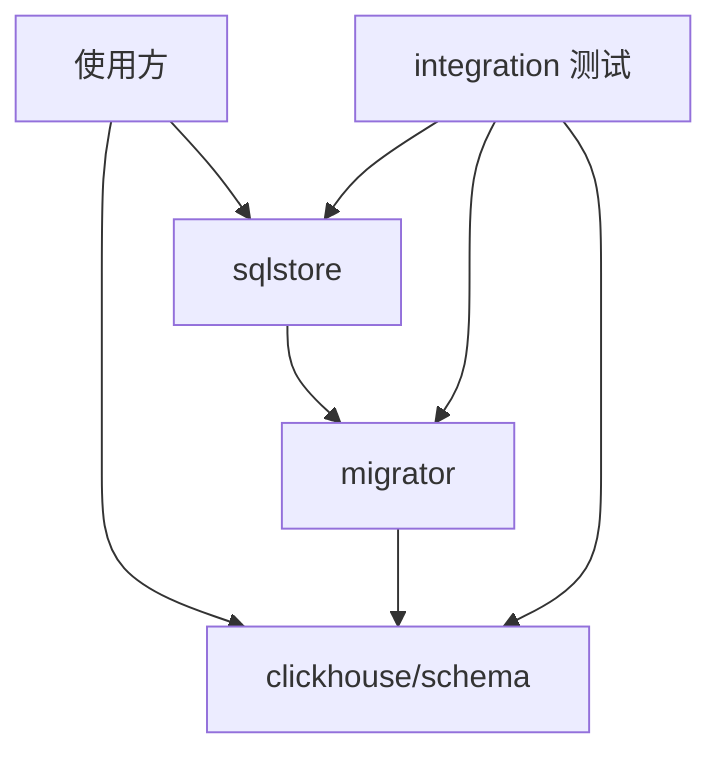

# storekit Architecture

storekit 提供 ClickHouse 建表 DSL、迁移引擎和 GORM 存储封装。仓库没有应用入口、业务 schema 或根 Go module。
三个库的已发布版本和安装命令见 [README](README.md#使用)。代码边界由各 module 的 `go.mod` 和 `scripts/verify-modules.py` 的依赖检查持有。

| Module | 职责 | 仓库内依赖 |
|---|---|---|
| `clickhouse/schema` | 表、列、视图和 SQL 渲染 | 无 |
| `migrator` | 方言、迁移执行和历史表 | schema |
| `sqlstore` | 连接、事务、重试和 tracing | migrator |
| `integration` | 外部消费者、驱动及服务端验收 | 上述三个库；只含测试，不发 tag |

**运行职责分界：** `migrator` 负责迁移执行与历史记录的错误传播；部署编排由宿主负责。一个数据库同一时间只能由一个迁移执行者操作（建议独立 Migration Job），`migrator` 不含跨进程会话锁。不要将迁移历史查询当作互斥机制。默认关系型历史存储在支持事务的方言上使迁移及成功记录同一事务提交；MySQL/ClickHouse 的非事务 DDL 不提供此保证。具体行为见 [migrator](migrator/README.md)。

生产库不得依赖 integration 或宿主应用。schema 不带查询语言元数据、宿主配置或时区默认策略。
sqlstore 核心不导入驱动；宿主显式选用 mysql/postgres/sqlite/clickhouse 子包。
`sqlstoretest` 为测试便利会导入多个驱动，不用于生产程序集成。

验证脚本按依赖顺序将当前工作树打包为带 `-0.local` 后缀的候选版本并写入临时 Go proxy，再复制 integration 到隔离目录测试。候选版本与已发布 tag 分开，避免工作树变化影响已发布版本的校验和。
测试关闭 workspace、拒绝 replace，使用全新候选缓存；integration 不加入候选发布集合。
普通 `make test` 不连接服务端；集成模式单独启用 Docker 夹具或 GitHub Actions 服务。目前服务端测试通过 `-run TestDriverIntegration` 选择执行范围，不能把所有 `integration` 构建标签下的测试视为已经验收。

模块边界由本仓库维护；实际使用方的接入和发布验收由各使用方记录。

实际使用方的生产接入尚未由本仓库验收。版本发布和 CI 通过都不代表业务环境迁移完成。
